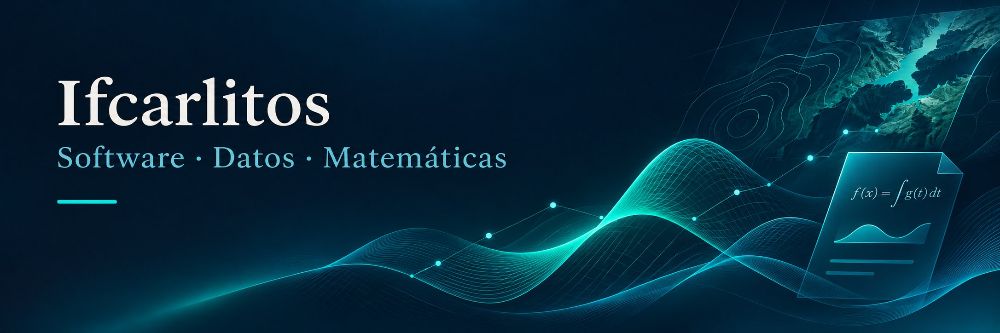

  

# Ifcarlitos · Software, datos y matemáticas

Desarrollo software y exploro problemas con datos y matemáticas. Aquí reúno herramientas de escritorio, proyectos de visión artificial y trabajos de análisis reproducible.

Me interesa conectar la teoría con aplicaciones que se puedan usar, estudiar y mejorar.

**Software development · Data science · Applied mathematics**

## Proyectos destacados

| Proyecto | Qué encontrarás | Tecnologías |
| :--- | :--- | :--- |
| **[ScribeTex](https://github.com/Ifcarlitos/ScribeTex)** | Editor visual que genera PDF con LaTeX. Fórmulas guiadas y modo matemático avanzado en Windows, Linux y macOS. | React · TypeScript · Tauri · Rust |
| **[Procesamiento de imágenes con wavelets](https://github.com/Ifcarlitos/TFM_UJI_MMC)** | Desarrollo teórico, reducción de ruido, extracción de características y clasificación sobre PathMNIST. | Python · Wavelets · Machine learning |
| **[Visión artificial para conservación marina](https://github.com/Ifcarlitos/TFM_UOC_MCD)** | Detección y segmentación de huellas de tortugas marinas mediante aprendizaje profundo. | Python · YOLOv8 · U-Net · OpenCV |
| **[Análisis territorial con Sentinel-2](https://github.com/Ifcarlitos/TFG_VIU_ING_INF)** | Segmentación del territorio, detección de estructuras y análisis multitemporal de imágenes satelitales. | Python · U-Net · YOLOv8 |
| **[Análisis de precios de supermercados](https://github.com/Ifcarlitos/UJI_SIQ525__Proyecto_analisis_datos)** | Extracción y limpieza de datos, modelización estadística y visualización interactiva. | Python · R · Shiny · Plotly |
| **[Python para matemáticas y datos](https://github.com/Ifcarlitos/python-math-data-course)** | Material organizado por fundamentos, cálculo, estadística, ciencia de datos y aprendizaje automático. | Python · Jupyter · NumPy · pandas |

## En qué trabajo

- **Software útil:** interfaces visuales, aplicaciones de escritorio y generación de documentos.
- **Visión artificial:** detección, segmentación y procesamiento de imágenes.
- **Matemáticas y datos:** wavelets, estadística, predicción y optimización.
- **Conocimiento compartido:** notebooks, documentación y materiales de aprendizaje.

## Herramientas que aparecen en mis proyectos

**Datos y modelos:** Python · R · NumPy · pandas · scikit-learn · PyTorch · TensorFlow · OpenCV  
**Aplicaciones:** React · TypeScript · Tailwind CSS · Tauri · Rust  
**Trabajo científico:** Jupyter · LaTeX · Git · GitHub

<strong>Más proyectos: predicción y optimización</strong>

- [Predicción de precios de la electricidad](https://github.com/Ifcarlitos/Tfg_Economia): aprendizaje automático aplicado al mercado eléctrico.
- [Cadena de suministro y aprendizaje automático](https://github.com/Ifcarlitos/TFB_Ing_Org_Ind): predicción de demanda y gestión de inventarios.

## Explora y participa

Cada repositorio incluye su contexto, documentación y condiciones de uso. Si tienes una idea o encuentras una mejora, puedes abrir un issue en el proyecto correspondiente.

[**Ver todos mis repositorios públicos →**](https://github.com/Ifcarlitos?tab=repositories&type=public)

---

Building useful software and exploring real-world problems through data, computer vision and applied mathematics.
